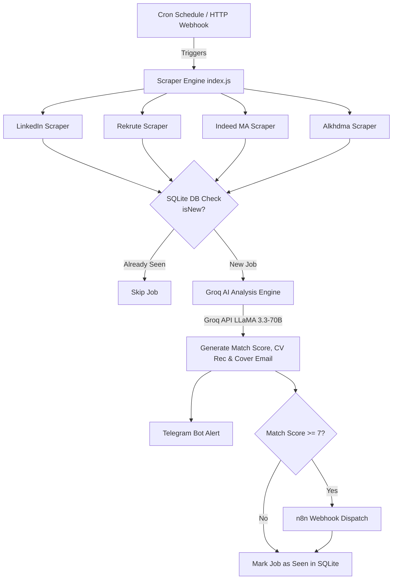

# 🤖 JobHunter Bot

> **AI-Powered Automated Job Search, Matching & Notification Engine**

JobHunter Bot is an end-to-end automated job hunting system built with **Node.js**, **Playwright**, **Groq LLM (LLaMA 3.3 70B)**, **SQLite**, **Telegram Bot API**, and **n8n Automation Engine**. 

It continuously monitors top job portals in Morocco and internationally, analyzes job postings against a candidate's specific profile, generates match scores with tailored application emails, selects the optimal CV version, sends instant Telegram alerts, and triggers downstream workflow automations.

---

## 🌟 Key Capabilities & Features

### 1. 🔍 Multi-Source Automated Web Scraping
- **LinkedIn Jobs Scraper** (`scrapers/linkedin.js`): Headless browser scraping for targeted cybersecurity, SOC, and IT job roles in Morocco filtered by real-time posting timestamps.
- **Rekrute.com Scraper** (`scrapers/rekrute.js`): Automated extraction of IT/Cybersecurity opportunities from Rekrute Morocco.
- **Indeed MA Scraper** (`scrapers/indeed.js`): Dynamic extraction of job listings from `ma.indeed.com`.
- **Alkhdma Portal Scraper** (`scrapers/alkhdma.js`): Scrapes public and private job announcements from `alkhdma.com`.
- **Extensible Test Suite**: Built-in test harnesses for OptionCarrière, DreamJob, and stealth scraping mechanisms.

### 2. 🧠 Groq AI Matching & Scoring Engine (`groq.js`)
- **LLaMA 3.3 70B Deep Analysis**: Evaluates raw job descriptions against the candidate's professional profile (SOC N1, SIEM/ELK, ISO 27005/EBIOS, CompTIA Security+, ASP.NET Core 8, Python, Docker, n8n).
- **Intelligent 1-10 Match Scoring**:
  - **9-10**: Junior / Internship / Alternance roles matching >80% of skills.
  - **7-8**: Standard roles matching >60% of skills.
  - **5-6**: Partial skill match or 1-3 years experience required.
  - **3-4**: Senior roles (3-5 years) with significant skill gap.
  - **1-2**: Managerial/Architect level (>5 years) or unrelated fields.
- **Automatic Hard Exclusion Rules**: Instantly penalizes (score max 3) positions outside target geography without explicit remote options, incompatible tech stacks, or irrelevant sectors.
- **CV Variant Recommendation Engine**: Automatically selects the most compelling CV version for each application:
  - `cv_thales`: Cybersecurity, SOC Analyst, Blue Team, SIEM, Threat Detection.
  - `cv_cfg`: GRC, IT Audit, Compliance, EBIOS, ISO 27005, Banking/Finance.
  - `cv_cegid`: Software Engineering, ASP.NET Core, API, Backend.
  - `cv_exploitation`: IT Operations, Systems Administration, Support N1/N2.
  - `cv_general`: Fallback for general/mixed roles.
- **Automated Cover Letter & Email Generator**: Generates customized email subject lines and tailored cover email bodies for instant application submission.

### 3. ⚡ Storage & Deduplication (`db.js`)
- **SQLite Database** (`jobs.db`): Automatically stores unique job identifiers (`data-entity-urn`, `data-jk`, or URL hashes), titles, companies, and timestamps (`seen_at`).
- **Zero Duplicate Processing**: Guarantees that no job posting is processed, analyzed by AI, or notified twice.

### 4. 📢 Real-Time Alerting & n8n Workflow Integration
- **Telegram Bot Notifications** (`telegram.js`): Formatted Markdown messages sent directly to your Telegram chat including:
  - Role title, company, location, contract type, and salary details.
  - Match Score & AI justification.
  - Required skills & highlighted candidate strengths.
  - Pre-written application email subject & body.
  - Direct application link and source tag.
- **n8n Webhook Dispatch**: Automatically triggers an n8n workflow (`POST http://localhost:5678/webhook/jobs`) for high-matching job postings (**Score >= 7**) to initiate secondary automations (e.g., tracking sheets, automated applications).

### 5. ⏰ Automated Scheduling & Manual Trigger API
- **Cron Scheduler**: Runs automatically twice a day at 08:00 and 20:00 (`0 8,20 * * *`) configured for the `Africa/Casablanca` timezone.
- **HTTP Webhook Server**: Exposes an embedded HTTP endpoint (`POST http://localhost:3001/run`) allowing on-demand scraper triggers via webhooks or external tools.

---

## 🏗 System Architecture



---

## 📁 Project Structure

```
jobhunter-bot/
├── docker-compose.yml       # Docker Compose setup for n8n container
├── README.md                # Project documentation
├── scraper/
│   ├── index.js             # Main orchestrator, cron schedule & HTTP server
│   ├── config.js            # Target keywords, locations, contract types & env setup
│   ├── db.js                # SQLite database interface (jobs.db)
│   ├── groq.js              # Groq API LLaMA 3.3-70B candidate evaluation module
│   ├── telegram.js          # Telegram Bot messaging integration
│   ├── import-workflows.js  # Automated n8n workflow importer script
│   ├── scrapers/
│   │   ├── linkedin.js      # LinkedIn Playwright scraper
│   │   ├── rekrute.js       # Rekrute Playwright scraper
│   │   ├── indeed.js        # Indeed MA Playwright scraper
│   │   └── alkhdma.js       # Alkhdma Playwright scraper
│   └── test_*.js            # Scraper diagnostic & test scripts
└── n8n-data/                # Persistent volume storage for n8n workflows & config
```

---

## 🚀 Quick Start Guide

### Prerequisites
- **Node.js** v18+ installed
- **Docker & Docker Compose** (for running n8n)
- **Groq API Key** (for LLaMA 3.3-70B evaluation)
- **Telegram Bot Token & Chat ID**

### 1. Environment Setup
Create a `.env` file in the `scraper/` folder:

```env
TELEGRAM_TOKEN=your_telegram_bot_token
TELEGRAM_CHAT_ID=your_telegram_chat_id
GROQ_API_KEY=your_groq_api_key
```

### 2. Install Dependencies
Navigate to the scraper directory and install dependencies:

```bash
cd scraper
npm install
npx playwright install chromium
```

### 3. Launch n8n Container
Start the n8n automation engine:

```bash
docker-compose up -d
```

### 4. Run the Job Hunter Bot
Start the main bot process (starts cron schedule + webhook server + initial scraping run):

```bash
cd scraper
node index.js
```

Or trigger an immediate run via HTTP request:

```bash
curl -X POST http://localhost:3001/run
```

---

## ⚙️ Configuration (`scraper/config.js`)

Customize keywords, search locations, and target contract types:

```javascript
module.exports = {
  keywords: [
    'SOC Analyst', 'Cybersecurity Engineer', 'IT Security',
    'Analyste Sécurité', 'Ingénieur Sécurité', 'Cyberdefense',
    'Security Operations', 'SIEM', 'stage cybersécurité',
    'alternance sécurité', 'penetration tester'
  ],
  locations: ['Casablanca', 'Rabat', 'Maroc', 'Remote'],
  contractTypes: ['CDI', 'CDD', 'Stage', 'Alternance', 'CI'],
};
```

---

## 📜 License

ISC License. Built for automated candidate job hunting & career acceleration.
